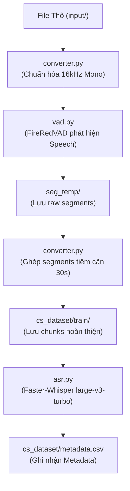

# ASR Dataset Builder Pipeline 🎙️

Pipeline tự động hóa quy trình xây dựng dataset cho các mô hình Nhận Dạng Giọng Nói Tự Động (ASR - Automatic Speech Recognition), đặc biệt tối ưu cho các bài toán **Code-Switching (CS)** và mô hình kiến trúc **Whisper**.

---

## 🌟 Tính Năng Nổi Bật

- **Chuẩn hóa Âm Thanh**: Tự động chuyển đổi các định dạng âm thanh đầu vào (`.wav`, `.mp3`, `.m4a`, `.flac`, `.ogg`...) về chuẩn **16kHz, Mono, 16-bit PCM WAV**.
- **Voice Activity Detection (VAD)**: Tích hợp mô hình SOTA **FireRedVAD** để lọc bỏ khoảng lặng và phát hiện chính xác các phân đoạn có giọng nói.
- **Ghép Phân Đoạn Thông Minh ($\le 30$s)**: Ghép nối tuần tự các segment ngắn theo trình tự thời gian sao cho thời lượng tiệm cận **30 giây** (ngưỡng hoạt động tối ưu nhất của kiến trúc Whisper), tránh phân mảnh dataset.
- **Tự Động Gán Nhãn (Pseudo-Labeling)**: Sử dụng **Faster-Whisper** (`large-v3-turbo`) với hiệu năng cao và hỗ trợ tăng tốc GPU qua CUDA.
- **Xuất Metadata Chuẩn**: Tự động trích xuất và lưu thông tin mẫu vào file `metadata.csv` phục vụ trực tiếp cho quá trình huấn luyện.

---

## 📁 Cấu Trúc Thư Mục

```text
build-cs-dataset/
├── .env                       # File cấu hình biến môi trường
├── .env.example               # Template cấu hình mẫu
├── .gitignore                 # Bỏ qua dataset, model weights và cache
├── requirements.txt           # Danh sách thư viện cần thiết
├── setup_env.ps1              # Script cài đặt môi trường tự động (PowerShell)
├── converter.py               # Xử lý âm thanh & thuật toán nối segment < 30s
├── vad.py                     # Module nhận diện tiếng nói với FireRedVAD
├── asr.py                     # Module phiên dịch với Faster-Whisper
├── main.py                    # Script điều khiển chính (CLI pipeline)
├── input/                     # Thư mục chứa audio đầu vào ({user_id}/*.ogg)
├── seg_temp/                  # Thư mục chứa audio trung gian & raw segments
└── cs_dataset/
    ├── train/                 # Audio chunks hoàn thiện ({user_id}/*.wav)
    └── metadata.csv           # File metadata của dataset
```

---

## ⚙️ Cài Đặt Môi Trường

> **Yêu cầu**: 
> - Hệ điều hành: **Windows 10/11**
> - **Python 3.10+**
> - **FFmpeg**: Đã cài đặt và thêm vào biến môi trường `PATH` của hệ thống.

### 1. Cài đặt tự động (Khuyến nghị)
Mở PowerShell tại thư mục dự án và chạy script:

```powershell
.\setup_env.ps1
```

Script sẽ tự động:
1. Cài đặt các package cần thiết từ `requirements.txt` (bao gồm `torch`, `fireredvad`, `faster-whisper`...).
2. Tải sẵn weights của mô hình `FireRedVAD` về thư mục `pretrained_models/`.

---

## 🛠️ Cấu Hình (`.env`)

Bạn có thể tùy chỉnh các tham số trong file `.env`:

```env
# Thư mục làm việc
INPUT_DIR=input
TEMP_SEG_DIR=seg_temp
OUTPUT_DIR=cs_dataset
TRAIN_DIR=cs_dataset/train
METADATA_FILE=cs_dataset/metadata.csv

# Cấu hình thời lượng & VAD
MAX_CHUNK_DURATION=30.0
VAD_MODEL_DIR=pretrained_models/FireRedVAD/VAD
VAD_SPEECH_THRESHOLD=0.4
VAD_MIN_SPEECH_FRAME=20
VAD_MAX_SPEECH_FRAME=2000

# Cấu hình ASR Model
WHISPER_MODEL=large-v3-turbo
WHISPER_LANG=vi
DEVICE=cuda
COMPUTE_TYPE=float16
```

---

## 🚀 Hướng Dẫn Sử Dụng

### Bước 1: Chuẩn bị file âm thanh
Tải tự động các file ghi âm từ danh sách URL trong `link/`:

```powershell
# Tải toàn bộ 395 file
python download_tracks.py

# Hoặc chỉ tải trước một số phòng nhất định (ví dụ 5 phòng đầu)
python download_tracks.py --num_rooms 5
```

Các file audio tải về sẽ tự động được phân nhóm chuẩn trực tiếp theo thư mục user: `input/{user_id}/`.
Nếu bạn đã có sẵn file ở cấp thư mục cũ, script sẽ tự động sắp xếp lại (hoặc chạy `python download_tracks.py --reorganize`).

### Bước 2: Chạy Pipeline Build Dataset
Sử dụng lệnh `python main.py` với các tùy chọn:
- `--type` (Bắt buộc): Loại dữ liệu (ví dụ: `cs` cho Code-Switching, `mono_vi`...).
- `--num_users` (Khuyến nghị khi test): Số lượng thư mục `user_id` muốn xử lý trước từ `input/` (ví dụ: `5`, `10`...).
- `--users`: Chỉ định cụ thể danh sách `user_id` cách nhau bởi dấu phẩy.
- `--num_rooms`: Số phòng muốn chọn từ file CSV để build dataset.
- `--rooms`: Chỉ định cụ thể danh sách `room_id` cách nhau bởi dấu phẩy.
- `--speaker_id`: ID người nói (mặc định là `auto` - tự động trích xuất `user_id` từ folder cha).

**Ví dụ:**
```powershell
# Chạy STT cho 5 user đầu tiên trong input/:
python main.py --type "cs" --num_users 5

# Chạy STT cho 10 user:
python main.py --type "cs" --num_users 10

# Chạy STT cho các user cụ thể:
python main.py --type "cs" --users "1779484387973271552,1779509763680243712"

# Build cho toàn bộ các file trong thư mục input:
python main.py --type "cs"
```

### Sửa transcript & Đánh dấu kiểm duyệt đa người dùng (Multi-User Review App)

Chạy app review hỗ trợ nhiều người cùng làm việc đồng thời (không cần cài package ngoài hay database):

```powershell
python review_app.py
```

- Mở `http://127.0.0.1:8765` trên máy hoặc `http://<IP_LAN>:8765` từ các máy khác trong mạng nội bộ (hoặc qua Cloudflare Tunnel / Ngrok / Tailscale để chia sẻ ra Internet).
- **Hỗ trợ đa người dùng (Multi-User Collaboration):**
  - **Định danh người duyệt (Reviewer ID):** Nhập tên của bạn ở ô **👤 Người duyệt** trên góc phải. Tên được lưu tự động vào `localStorage` và ghi vào cột `verified_by` trong `metadata.csv` khi duyệt.
  - **Khóa mẫu tự động (Auto-Claim & Heartbeat):** Khi bạn mở một mẫu, app tự động cấp quyền khóa chỉnh sửa (Claim) cho bạn. Người khác mở mẫu đó sẽ thấy cảnh báo: `⚠️ Đang được review bởi [Tên]` và có nút `⏭️ Nhảy sang mẫu trống khác`.
  - **Tự động bỏ qua thông minh (Auto-Skipping):** Khi bấm `✅ Đã duyệt & Tiếp →` (`Ctrl+Enter`) hoặc `Tiếp →`, app sẽ tự động tìm mẫu chưa duyệt tiếp theo và **bỏ qua tất cả các mẫu đang có người khác làm**, giúp nhiều người phối hợp mượt mà không bị trùng lặp.
  - **Hiển thị hiện diện thời gian thực (Live Presence):** Sidebar hiển thị ngay lập tức badge `🟡 [Tên]` cho mẫu đang có người làm, `🔵 Tôi` cho mẫu bạn đang giữ, và `✅ [Tên]` cho mẫu đã duyệt.
  - **Bộ lọc đa dạng:** Thanh bên có các tab: `Tất cả`, `⏳ Chưa duyệt`, `✅ Đã duyệt`, và `👤 Của tôi` (xem các mẫu do chính bạn đã duyệt).
  - **An toàn dữ liệu:** Backend sử dụng `threading.RLock()` đảm bảo việc lưu đồng thời từ nhiều người không bao giờ làm lỗi file `metadata.csv`.
- **Thanh bên EXPLORER (phong cách VS Code):** Linh hoạt lọc và duyệt theo từng folder `user_id`.
- **Phím tắt nhanh:** `Space` (phát/dừng), `←`/`→` (tua audio liên tục), `[`/`]` (mẫu trước/tiếp), `Ctrl+S` (lưu), `Ctrl+Enter` (duyệt & tiếp), `Ctrl+B` (thu gọn sidebar).

---

## 📊 Định Dạng Metadata (`metadata.csv`)

File `cs_dataset/metadata.csv` được sinh ra với cấu trúc như sau:

| Cột | Ý Nghĩa | Ví Dụ |
| :--- | :--- | :--- |
| `id` | Mã định danh duy nhất (UUID) | `a07dbeda-b7f9-4e27-953a-da6d0393bb83` |
| `audio_path` | Đường dẫn file tương đối trong dataset | `train/{user_id}/sample_0001.wav` |
| `text` | Văn bản phiên dịch từ audio | `Nếu thường xuyên lướt TikTok...` |
| `duration` | Thời lượng file (giây) | `29.94` |
| `type` | Loại dữ liệu phân loại | `cs` |
| `speaker_id` | ID người nói | `1831539783235538944` |
| `is_verified` | Đã kiểm duyệt transcript hay chưa | `True` / `False` |
| `verified_by` | Tên người kiểm duyệt mẫu này | `Tuyen`, `Huong` |

---

## 📜 Luồng Xử Lý Chi Tiết (Pipeline Flow)


